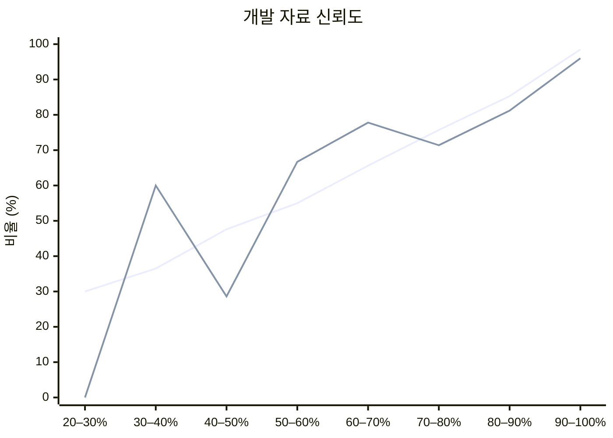
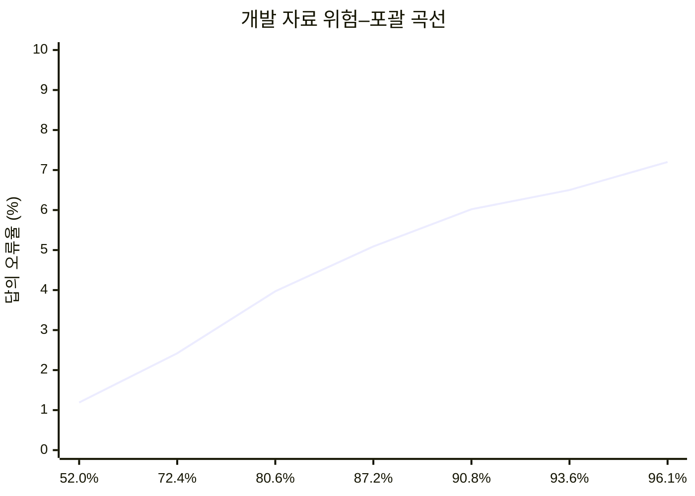

# TV-13 기준 실측 보고서

- **측정 기준은 `claude/great-planck-vnvyxx`의 `421cbb2`입니다.** 빠른 CI의 부모 프로세스만 측정하면 줄 29.22%이고, 자식 프로세스를 포함하면 `src/`·`tools/` 줄 37.76%, 분기 26.23%입니다.
- **Train/Test의 촬영 세션 13개와 감자·고구마 개발 사진 9장의 학습 특징 유사도가 재현됐습니다.** 두 경로의 전처리는 Valid 20장에서 일치했고, 첫째 CLIP 분류기의 원본 재학습에 필요한 자료는 확보하지 못했습니다.
- **TV-13의 개발 세트 보류 기준 0.90에서 80.60%에 답했고, 그중 96.03%가 맞았습니다.** 개발 세트는 모델 선택에 사용됐습니다. T9는 당시 저장된 집계만 읽었습니다.

## 묶음별 판정

| 묶음 | 충족 | 일부 | 미충족 | 측정 못 함 | 항목 |
|---|---:|---:|---:|---:|---:|
| 일반 코드 품질 | 3 | 11 | 1 | 0 | 15 |
| 머신러닝 시스템 | 6 | 30 | 17 | 0 | 53 |
| 재현성과 데이터 누수 | 10 | 12 | 3 | 2 | 27 |
| 평가 방법 | 6 | 2 | 0 | 0 | 8 |
| **실측·대조 합계** | **25** | **55** | **21** | **2** | **103** |
| 프로젝트 대조표 | 1 | 0 | 0 | 0 | 1 |

`충족`은 항목의 검증 목적을 만족했다는 뜻입니다. `일부`는 검사 범위나 통제에 제한이 있다는 뜻이고, `미충족`은 기준에 필요한 통제가 빠졌다는 뜻입니다. `측정 못 함`은 원본 자료나 사용자 승인이 필요한 경우입니다. 5번은 1~4번을 모은 아래 표의 완성 여부입니다. `docs/code_review.md`의 기존 **72점은 유지**했습니다. 재현 범위 차이로 달라진 값은 복잡도 표본 수(148 → 143), 자식 프로세스 포함 커버리지(29% → 37.76%)입니다. Ruff 138건과 Vulture 3건은 조건을 명시해 재현했습니다.

## 측정 기준과 출처

- 일반 코드 품질의 8가지 특성에는 ISO/IEC 25010:2011의 제품 품질 모델을 적용했습니다. 8개 특성을 요구한 작업 범위에 맞춰 이 판본을 사용했습니다. 정적 검사와 테스트 범위는 별도 수치로 적었습니다. [ISO/IEC 25010:2011](https://www.iso.org/standard/35733.html)
- ML Test Score는 Breck 외의 표 I–IV에 있는 28개 항목을 사용했습니다. 이 저장소에서 없음 0, 수동 0.5, 관련 자동 검사 1입니다. 최종값은 논문 방식대로 네 영역 합계의 최솟값입니다. 데이터 **2.5/7**, 모델 **2/7**, 인프라 **3/7**, 모니터링 **0/7**, 최종 **0/7**입니다. [Breck 외, ML Test Score](https://research.google/pubs/the-ml-test-score-a-rubric-for-ml-production-readiness-and-technical-debt-reduction/) · [원문 표 I–IV와 §VI.A](https://static.googleusercontent.com/media/research.google.com/en//pubs/archive/aad9f93b86b7addfea4c419b9100c6cdd26cacea.pdf)
- 문서와 기술 부채는 Model Cards §4, Datasheets §3, Sculley 외의 유형을 대조했습니다. 부채 수는 표에 적은 파일 수, 기능 수, 설정군 수처럼 행마다 단위가 다릅니다. [Model Cards](https://arxiv.org/pdf/1810.03993) · [Datasheets for Datasets](https://arxiv.org/pdf/1803.09010) · [Hidden Technical Debt](https://papers.nips.cc/paper_files/paper/2015/file/86df7dcfd896fcaf2674f757a2463eba-Paper.pdf)
- 누수는 Kapoor & Narayanan의 여덟 유형을, 재현성은 NeurIPS 체크리스트 중 이 프로젝트에 적용되는 항목을 대조했습니다. 라벨 후보는 저장된 특징에서 교차 검증으로 얻은 확률에 confident learning을 적용했습니다. [Kapoor & Narayanan](https://doi.org/10.1016/j.patter.2023.100804) · [NeurIPS 체크리스트](https://neurips.cc/public/guides/PaperChecklist) · [Confident Learning](https://arxiv.org/abs/1911.00068)

## 실행 명령

명령에서 `$audit`는 체크아웃 밖 임시 디렉터리입니다. **실행**은 명령을 실제로 돌렸다는 뜻이며, **읽기**는 정적 열람이나 목록 검색으로 끝났다는 뜻입니다. 통계에 사용한 원 출력, 클래스별 구간, 판정에 사용한 행 ID는 [측정 JSON](../results/criteria/measurements.json)에 있습니다.

| ID | 방식 | 명령 |
|---|---|---|
| Q1 | 실행 | `python tools/criteria/quality.py --out "$audit/quality.json"`. `git ls-files`와 Python AST로 추적된 `src/`, `tools/`의 함수만 Radon 6.0.1로 계산. 새 측정 도구는 제외 |
| Q2 | 실행 | `python -m ruff check --target-version py39 --line-length 160 --select E,F,W,B,C90,SIM --statistics src tools --exclude 'tools/criteria/*'`. py311도 같은 설정으로 별도 확인 |
| Q3 | 실행 | `python -m vulture @(git ls-files 'src/*.py' 'tools/*.py') --min-confidence 90`. 100%에서도 별도 확인 |
| Q4 | 실행 | 아래 coverage 명령. 빠른 테스트와 전체 시스템 각각 별도 측정 |
| Q5 | 실행 | `jscpd --format python --ignore '**/criteria/**' --min-lines 5 --min-tokens 50 --reporters json --output "$audit/jscpd-$folder" $folder`를 src, tools, experiments에 각각 실행 |
| Q6 | 실행 | `python -m mypy --ignore-missing-imports --cache-dir "$audit/mypy" --show-error-codes --no-pretty src` |
| R | 읽기 | `git show 421cbb2:docs/training_and_evaluation.md`, `rg -n 'apply_crop_check|five_crops|--untrained|--clip-arch|FULL_TESTS' src tests docs results experiments .github`. 표의 근거 줄과 명세 원문을 열람 |
| X | 읽기·파일 집계 | `git ls-files`, `rg -l 'sys\.path\.insert|spec_from_file_location' experiments results -g '*.py'`, `rg -l 'DEPP_WORK' experiments -g '*.py'`, 삭제 자원 경로와 `model.pth` 참조를 이름·호출부로 대조. `rg --files --hidden -g 'extra_train_N3.csv'`로 첫째 헤드 자료 검색 |
| P | 실행 | `python tools/criteria/images_probe.py probe --out "$audit/images.json"`. 기본 Valid 사진 20장. T3~T9 입력 없음 |
| O | 실행 | `python tools/criteria/images_probe.py test-embeddings --out "$audit/test-embeddings.npz"` 후 `python tools/criteria/overlap.py --test-embeddings "$audit/test-embeddings.npz" --out "$audit/overlap.json"`. 기본 Test는 유사도 측정에만 사용. 점수 등락은 저장된 분류 기록의 부분집합 산술 |
| L | 실행 | `python tools/criteria/retrain_and_labels.py labels --out "$audit/labels.json"`. 개발 특징과 로짓으로 그룹을 보존한 3-fold out-of-fold 확률 산출 |
| T | 실행 | `python tools/criteria/retrain_and_labels.py retrain --out "$audit/retrain.json"`. 시드 42·43·44, 둘째 헤드의 실제 CLI를 임시 체크포인트에 실행. 첫째는 대체 특징으로 실행 |
| V | 실행 | `python tools/criteria/evaluate.py --bootstrap 1000 --out "$audit/evaluate.json"`. `development_sets()`의 저장 입력으로 TV-12/13 판정. T9는 `scores_once.json`의 저장된 행만 비교 |
| B | 실행 | `python tools/baseline_card.py --check`. TV-13 기준선 기록과 현재 파일 일치 |

```powershell
# 임시 coverage.ini는 branch=True, parallel=True를 켜고,
# source=src, tools, experiments, results, dataset/tools를 추적한다.
# PYTHONPATH 앞의 임시 sitecustomize.py가 coverage.process_startup()을 부른다.
$env:COVERAGE_PROCESS_START = "$audit/coverage.ini"
$env:COVERAGE_FILE = "$audit/.coverage-fast"
python -m pytest -q -r s
python -m coverage combine --keep --rcfile "$audit/coverage.ini"
$tracked = @(git ls-files 'src/*.py' 'tools/*.py' 'experiments/*.py' 'results/*.py' 'dataset/tools/*.py')
python -m coverage json --rcfile "$audit/coverage.ini" -o "$audit/coverage-fast-tracked.json" @tracked

# 전체는 별도 파일명과 FULL_TESTS=1로 같은 명령을 실행했다.
# 부모 프로세스 비교는 autostart를 내린 별도 셸에서 실행했다.
python -m coverage run --branch --source=src,tools -m pytest -q
```

줄 커버리지는 실행 가능한 문장, 분기 커버리지는 실행 가능한 분기를 분모로 삼았습니다. 넓은 범위는 추적 중인 구현 파일 92개입니다. 테스트 코드 자체는 분모에서 뺐습니다.

| 실행 | pytest 결과 | src·tools | 구현 파일 92개 전체 |
|---|---|---|---|
| 빠른 테스트, 부모만 | 55 통과·5 건너뜀 (145.50초) | 줄 561/1920 (29.22%), 분기 102/488 (20.90%) | 범위 밖 |
| 빠른 테스트, 자식 포함 | 55 통과·5 건너뜀 (204.15초) | 줄 725/1920 (37.76%), 분기 128/488 (26.23%) | 줄 914/6746 (13.55%), 분기 187/1766 (10.59%) |
| 전체, 자식 포함, 기존 프로젝트 환경 | 60 통과 (470.99초) | 줄 895/1920 (46.61%), 분기 173/488 (35.45%) | 줄 1084/6746 (16.07%), 분기 232/1766 (13.14%) |
| 전체, 자식 포함, 분석 패키지도 설치된 환경 | 59 통과·1 실패 (537.98초) | 줄 895/1920 (46.61%), 분기 173/488 (35.45%) | 줄 1084/6746 (16.07%), 분기 232/1766 (13.14%) |

빠른 테스트에서 건너뛴 5건은 CLIP CLI를 쓰는 케이스입니다. 자식까지 추적한 src/predict.py는 빠른 테스트에서 줄 73/189 (38.62%), 분기 10/52 (19.23%), 전체 환경에서 줄 175/189 (92.59%), 분기 43/52 (82.69%)입니다. 분석 패키지가 설치된 환경(Pillow 13.0.0, NumPy 2.5.5)에서는 골든 CLI의 피망 확률 한 건이 **0.9221**로, 기록 **0.9246**에서 허용치 0.002를 넘었습니다. 기존 프로젝트 환경은 Pillow 12.3.0·NumPy 2.5.3이며, 패키지 하나씩의 인과관계는 검증하지 않았습니다. 두 실행 모두 골든 파일을 있는 그대로 읽었습니다.

## 프로젝트 대조표

### 1. 일반 코드 품질

| 기준 | 출처 | 실행·읽기 | 측정값·관찰 | 판정 | 근거 파일:줄 | 작업량 |
|---|---|---|---|---|---|---|
| Q1 함수 복잡도 재현 | 기존 측정 | Q1 | 143개 · 123/13/7. 기존 148개 · 128/13/7과 앞 구간만 다름 | **일부** | `src/train.py:222`, `tools/rebuild_head_photos.py:61` | 중간 |
| Q2 Ruff 재현 | 기존 측정 | Q2 | py39 호환 규칙 138건 일치. 프로젝트 Python 3.11 기준 161건 | **충족** | `src/train.py:222`, `tools/dataset_tools_equivalence.py:9` | 중간 |
| Q3 Vulture 재현 | 기존 측정 | Q3 | 신뢰도 90%에서 3건. 100%에서 2건 | **충족** | `src/networks.py:164`, `tools/dataset_tools_equivalence.py:9,68` | 작음 |
| Q4 빠른 줄·분기 커버리지 | coverage.py | Q4 | 부모만 줄 561/1920 (29.22%), 분기 102/488 (20.90%). 자식 포함 src/tools 줄 725/1920 (37.76%), 분기 128/488 (26.23%). 산정 범위에 따라 29%와 다름 | **일부** | `.github/workflows/tests.yml:8–23`, `tests/test_predict_outputs.py:132–151` | 중간 |
| Q5 전체 시스템 줄·분기 커버리지 | coverage.py | Q4 | 줄 895/1920 (46.61%), 분기 173/488 (35.45%) · 60 통과 (470.99초) | **충족** | `tests/test_project.py:136–171`, `tests/test_predict_outputs.py:59–84` | 중간 |
| Q6 토큰 중복률 | jscpd | Q5 | src 0%, tools 0%, experiments 12.61% (548/4,347줄, 45개 쌍) | **일부** | `experiments/new_vegetables/v5/build_pool.py:20–69`, `experiments/new_vegetables/v7/build_pool.py:19–66` | 중간 |
| Q7 정적 타입 검사 | mypy | Q6 | 15개 파일 중 4개에서 오류 16건 | **미충족** | `src/images.py:55`, `src/predict.py:123`, `src/networks.py:53–63`, `src/watermark_aug.py:47–132` | 중간 |
| I1 기능 적합성 | ISO | Q4,P | 20장 텐서·로짓 차이 0. 전체 CLI 골든은 환경에 의존 | **일부** | `src/predict.py:160–191`, `tests/test_project.py:165–171` | 작음 |
| I2 성능 효율 | ISO | P | CPU 단일 이미지 중앙값 0.517초(20장, 당시 부하 포함) · 웹 성능 목표 미측정 | **일부** | `src/predict.py:140–165`, `src/clip_model.py:66–86` | 중간 |
| I3 호환성 | ISO | Q4,R | Windows/Ubuntu 테스트 경로 · 실제 Spaces와 외부 API 연동 검증 0 | **일부** | `.github/workflows/tests.yml:8–23`, `requirements.txt:1–17` | 중간 |
| I4 사용성 | ISO | R | CLI·HTML 2개 출력 인터페이스 문서 확인. 사람 대상 과제 검증 기록 0 | **일부** | `README.md:260–299`, `src/report.py:76–99` | 중간 |
| I5 신뢰성 | ISO | Q4,R | 빠른 55건 통과, T9 봉인·원자 저장. 예측 출력 거부 공백 1건 | **일부** | `results/t9_test/score.py:147–173`, `src/predict.py:274–299` | 작음 |
| I6 보안 | ISO | R | 안전 로드·입력 경로 보호 2개 확인. 웹 업로드·접근통제 실증 0 | **일부** | `src/networks.py:111–120`, `src/predict.py:80–105` | 중간 |
| I7 유지보수성 | ISO | Q1,Q5,Q6 | 21 이상 함수 7개 · 실험 복제 45쌍 · 타입 오류 16건 | **일부** | `src/train.py:222–385`, `experiments/new_vegetables/v7/build_pool.py:19–66` | 중간 |
| I8 이식성 | ISO | Q4,R | 로컬 Windows 및 Linux 빠른 CI 기록. 빈 Spaces 배포 0회 | **일부** | `.github/workflows/tests.yml:8–23`, `src/clip_model.py:66–71` | 중간 |

### 2. 머신러닝 시스템

| 기준 | 출처 | 실행·읽기 | 측정값·관찰 | 판정 | 근거 파일:줄 | 작업량 |
|---|---|---|---|---|---|---|
| D1 특징·입력 스키마 | MLTS | Q4 | 1점 · 필수 열·분할·해시 자동 검사 | **충족** | `src/train.py:34–73`, `tests/test_manifest_checks.py:33–80` | 작음 |
| D2 특징별 기여 | MLTS | R | 0.5점 · CLIP·텍스트의 수동 비교 기록. 모든 특징의 제거 실험은 없음 | **일부** | `experiments/clip_classifier/README.md:1–24`, `results/t3_test/README.md:22–42` | 중간 |
| D3 특징별 비용 | MLTS | P | 0점 · 전체 예측 시간 20장만 측정. 특징 단위 비용 한도·검사 0 | **미충족** | `src/clip_model.py:66–86`, `src/predict.py:160–165` | 중간 |
| D4 특징 정책 | MLTS | R | 0.5점 · 사진 검수와 출처 정책이 기록됨. 라이선스 자동 적용은 없음 | **일부** | `dataset/README.md:54–81`, `data_sources.md:4–16` | 중간 |
| D5 데이터 프라이버시 | MLTS | R | 0점 · 저장소 밖에 두는 관리 기록은 있음. 접근·삭제 검증 0 | **미충족** | `data_sources.md:3–8`, `results/t9_test/RULES.md:22–29` | 중간 |
| D6 새 특징 도입 속도 | MLTS | R | 0점 · 개발→공개 서비스까지 측정된 소요시간 0개 | **미충족** | `docs/training_and_evaluation.md:15–26` | 중간 |
| D7 모든 입력 특징의 테스트 | MLTS | Q4,P | 0.5점 · CNN·가짜 특징·20장 실측. CLIP 전체 자동 경로는 환경 변수로 분리 | **일부** | `tests/test_project.py:71–117,136–171` | 중간 |
| M1 모델 명세 검토·형상 관리 | MLTS | R | 0.5점 · TV-13 명세와 채택 근거 확인. 검토·승인 강제 자동화 없음 | **일부** | `tools/baseline_card.py:41–80`, `results/baseline/README.md:3–11` | 작음 |
| M2 오프라인과 서비스 지표 상관 | MLTS | R | 0점 · 온라인 A/B·사용자 품질 비교 0회 | **미충족** | `docs/training_and_evaluation.md:76–103` | 큼 |
| M3 하이퍼파라미터 검증 | MLTS | T,R | 0.5점 · tau 후보 5개를 코드로 탐색하고 PC1 기준을 사전 기록 | **일부** | `src/train_new_veg_head.py:26–27,77–97`, `experiments/potato_check/PREREG.md:8–23` | 중간 |
| M4 모델 노후화 영향 | MLTS | R | 0점 · 기간별 독립 성능 곡선 또는 수명 검사 0 | **미충족** | `README.md:70–94` | 중간 |
| M5 간단한 모델 대조 | MLTS | R | 0.5점 · CNN·CLIP 결합 대조 기록 있음. 정기 검증 0 | **일부** | `experiments/clip_classifier/README.md:1–24`, `README.md:70–89` | 중간 |
| M6 중요한 하위집단 품질 | MLTS | V,R | 0.5점 · 클래스별 실측 15개 및 T9의 사전 조건. 합격 수준 자동 감시 없음 | **일부** | `tools/compare_on_dev.py:92–106`, `results/t9_test/score.py:93–99` | 중간 |
| M7 포용성 검증 | MLTS | R | 0점 · 대표 촬영 환경·사용자군을 정한 배포 수준 검증 0 | **미충족** | `dataset/README.md:123–130`, `data_sources.md:50–55` | 큼 |
| F1 재학습 재현성 | MLTS | T | 0.5점 · 둘째 헤드 3회 답 0개 차이. 저장 계수 비트 불일치와 첫째 원본 자료 부재 | **일부** | `src/train_new_veg_head.py:33–38`, `docs/training_and_evaluation.md:44–48` | 큼 |
| F2 모델 명세 단위 테스트 | MLTS | Q4 | 1점 · 클래스·가중치 체크섬·판정 형태를 자동 확인 | **충족** | `tests/test_project.py:53–103`, `src/networks.py:111–125` | 작음 |
| F3 파이프라인 통합 테스트 | MLTS | Q4,R | 0.5점 · 전체 예측은 실제 테스트, 학습→추론 1 epoch는 이력의 수동 실행 | **일부** | `tests/test_project.py:165–171`, `docs/codex_handoff.md:9–24` | 중간 |
| F4 서비스 전 모델 검증 | MLTS | R | 0.5점 · PC1 T9 사전 게이트와 사용자 채택. 배포 자동 차단 없음 | **일부** | `results/t9_test/RULES.md:78–91`, `docs/training_and_evaluation.md:3–9` | 중간 |
| F5 디버깅 가능 | MLTS | P,R | 0.5점 · CSV에 후보 확률과 오류, CLI에는 실패 사진의 경로를 남김. 서비스 요청 추적 없음 | **일부** | `src/predict.py:193–210,290–301` | 중간 |
| F6 카나리 배포 | MLTS | R | 0점 · 단계적 트래픽 배포 검증 0회 | **미충족** | `.github/workflows/tests.yml:8–23` | 큼 |
| F7 모델 롤백 훈련 | MLTS | R | 0점 · TV-12 이력은 있음. 서비스 롤백 실행 기록 0회 | **미충족** | `results/baseline/README.md:3–11`, `.github/workflows/tests.yml:8–23` | 중간 |
| O1 의존성 변경 알림 | MLTS | R | 0점 · 패키지 버전 고정은 있음. 운영 변경 알림 0 | **미충족** | `requirements.txt:1–17`, `.github/workflows/tests.yml:1–23` | 중간 |
| O2 운영 입력 불변식 감시 | MLTS | R | 0점 · 오프라인 해시 검사만 확인. 운영 스키마 감시 0 | **미충족** | `src/train.py:34–73`, `src/predict.py:278–295` | 중간 |
| O3 운영 학습·서빙 스큐 감시 | MLTS | P,R | 0점 · 20장 오프라인 일치. 실제 서비스 분포 비교 0 | **미충족** | `src/train.py:91–93`, `src/predict.py:147–165` | 중간 |
| O4 모델 노후화 알림 | MLTS | R | 0점 · 배포본 나이·최신성 알림 0 | **미충족** | `tools/baseline_card.py:41–80`, `.github/workflows/tests.yml:1–23` | 중간 |
| O5 수치 안정성 감시 | MLTS | V,R | 0점 · 오프라인 1,935행 유한값. 운영 NaN 경보 0 | **미충족** | `src/decision.py:155–207`, `tools/criteria/evaluate.py:127–188` | 중간 |
| O6 연산 성능 회귀 감시 | MLTS | P,R | 0점 · 20장 오프라인 측정. 운영 지연·메모리 경보 0 | **미충족** | `src/predict.py:256–301`, `.github/workflows/tests.yml:8–23` | 중간 |
| O7 운영 예측 품질 감시 | MLTS | R | 0점 · 개발 기준선은 있음. 운영 정답·드리프트 감시 0 | **미충족** | `tests/test_baseline_record.py:18–34`, `.github/workflows/tests.yml:8–23` | 큼 |
| P1 학습 검증↔실제 추론 전처리 | Rules of ML 32 | P | 20/20 일치. 텐서·로짓 최대 절댓값 0 | **충족** | `src/train.py:91–93`, `src/predict.py:147–165`, `tools/criteria/images_probe.py:65–90` | 작음 |
| C1 모델 세부 | Model Cards | R | TV-13·구조·일자·가중치 기록. 모델 라이선스·인용·연락처를 모은 항목 없음 | **일부** | `README.md:1–10`, `results/baseline/README.md:3–11` | 작음 |
| C2 사용 목적 | Model Cards | R | 채소 8종과 대파 제한 명시. 식품 안전·사용자군 등 사용 범위 문구 부족 | **일부** | `README.md:1–3,373–385` | 작음 |
| C3 영향 요인 | Model Cards | R | 흙·워터마크·배경·사진 출처 구분. 조명/기기별 요인 표 없음 | **일부** | `README.md:35–45`, `data_sources.md:50–55` | 작음 |
| C4 지표 | Model Cards | R | 정확도·거름·보류 기준과 일부 구간. 전체 클래스 불확실성은 기존 문서에 없음 | **일부** | `README.md:12–22`, `docs/training_and_evaluation.md:70–103` | 작음 |
| C5 평가 자료 | Model Cards | R | 출처·묶음·대표성과 평가 사용 제한 기록 | **충족** | `results/t9_test/RULES.md:10–45,65–91` | 작음 |
| C6 학습 자료 | Model Cards | R | 출처·분할·규모 기록. 첫 CLIP 원본 일부는 복원 불가 | **일부** | `data_sources.md:10–33`, `docs/training_and_evaluation.md:44–48` | 작음 |
| C7 정량 분석 | Model Cards | R | 클래스별 표는 있음. 촬영 조건×클래스의 교차 성능 없음 | **일부** | `docs/training_and_evaluation.md:76–103` | 작음 |
| C8 윤리 고려 | Model Cards | R | 데이터 라이선스 설명은 있음. 식품 안전에서의 오판·사진 프라이버시를 다룬 별도 항목 0 | **미충족** | `data_sources.md:3–8`, `README.md:373–385` | 작음 |
| C9 한계와 권고 | Model Cards | R | 출처 편향, 약점, 시험지 사용 제한 기록 | **충족** | `README.md:18–27`, `results/t9_test/README.md:61–67` | 작음 |
| S1 수집 동기 | Datasheets | R | 5종·2상태 판정 목적. 담당·재원 항목 없음 | **일부** | `dataset/README.md:1–5` | 작음 |
| S2 구성 | Datasheets | R | 1,860장, 분할, 균형, 라벨·메타데이터 명시 | **충족** | `dataset/README.md:28–52,123–128` | 작음 |
| S3 수집 과정 | Datasheets | R | 두 출처·육안 검수·분할 규칙. 모든 외부 자료 수집자·시점 명세는 없음 | **일부** | `dataset/README.md:54–86`, `data_sources.md:16–34` | 작음 |
| S4 처리·정제·라벨링 | Datasheets | R | 중복·유사 장면 규칙과 라벨 의미 기록. 이상 부위 주석은 0 | **일부** | `dataset/README.md:102–128` | 작음 |
| S5 사용 범위 | Datasheets | R | 학습·검증·시험 정의와 한계. 제외 용도와 사용자 위험 별도 기준 없음 | **일부** | `dataset/README.md:46–52,123–130` | 작음 |
| S6 배포 | Datasheets | R | 저장소/외부 자료 구분과 다운로드 도구. 외부 학습 자료 완전 복원 불가 | **일부** | `data_sources.md:3–14,35–48` | 작음 |
| S7 관리 | Datasheets | R | 데이터 버전 이력은 있음. 담당·갱신·이의제기·삭제 운영 절차 0 | **미충족** | `dataset/README.md:133–166` | 작음 |
| TD1 경계 침식·단계 결합 | Sculley | R,X | 결합 2종. 정규 CNN 체크포인트를 두 CLIP 헤드가 공유하고 판정은 순서에 의존 | **일부** | `src/decision.py:111–179`, `src/train_new_veg_head.py:41–44` | 중간 |
| TD2 접착 코드·추상화 | Sculley | R,X | 실험/결과의 sys.path 삽입 또는 파일 경로 동적 import가 52파일. exec 기반 내보내기 1개 사례 | **일부** | `experiments/new_vegetables/v7/export_head_data.py:5–13`, `results/t4_test/score.py:33–39` | 중간 |
| TD3 파이프라인 정글·데이터 의존 | Sculley | R,X | DEPP_WORK를 직접 참조하는 실험 Python 32파일. 삭제 자료를 직접 여는 4파일 | **일부** | `experiments/watermark/common.py:27–43`, `experiments/new_vegetables/v7/build_pool.py:19–22`, `docs/code_review.md:148–163` | 중간 |
| TD4 죽은 실험 경로 | Sculley | R,X | 현행 예측에 연결되지 않은 기능군 3개. 토마토 조각, 대파 제외 옵션, 백본 변경 옵션 | **일부** | `src/decision.py:220–244`, `src/train_new_veg_head.py:55–66`, `src/train_clip_head.py:96–107` | 중간 |
| TD5 숨은 소비자·버전 결합 | Sculley | R,X | 보관 채점 코드 8개에서 루트 현재 체크포인트를 예전 TV-12로 사용 | **일부** | `results/t4_test/score.py:101–105`, `results/t9_test/score.py:191–214`, `docs/code_review.md:202–209` | 중간 |
| TD6 설정 부채·의미 없는 기본 타입 | Sculley | R,X | 두 감자 기준·보류 기준·새 채소 전환 기준 3종이 코드·체크포인트·문서에 흩어짐. 반환 경계는 dict/숫자 | **일부** | `src/decision.py:134,182–208`, `src/predict.py:50–53,160–191`, `tools/baseline_card.py:65–71` | 중간 |
| TD7 프로토타입·특징 캐시 | Sculley | R,X | 외부 스크립트 실행과 이름 중심의 역사 캐시 2개 대표 사례 | **일부** | `experiments/new_vegetables/v7/export_head_data.py:8–10`, `experiments/watermark/common.py:59–78` | 중간 |
| TD8 외부 환경·피드백 부채 | Sculley | R,X | 출처 이동 1건 확인. 온라인 자체 피드백 루프 실행·검증은 0건 | **일부** | `data_sources.md:50–55`, `.github/workflows/tests.yml:8–23` | 중간 |

### 3. 재현성과 데이터 누수

| 기준 | 출처 | 실행·읽기 | 측정값·관찰 | 판정 | 근거 파일:줄 | 작업량 |
|---|---|---|---|---|---|---|
| L1.1 별도 테스트 없음 | Kapoor·Narayanan | R | 막혀 있음 · 기본 Train/Valid/Test와 T9 구분 | **충족** | `src/train.py:34–73`, `results/t9_test/RULES.md:72–91` | 중간 |
| L1.2 전처리를 시험까지 맞춤 | Kapoor·Narayanan | P,R | 막혀 있음(현행 경로) · Valid 보정과 Train 증강 분리, 20장 비교 값 0 | **충족** | `src/train.py:245–273,333–345`, `src/calibration.py:56–68` | 중간 |
| L1.3 시험으로 특징·후보 선택 | Kapoor·Narayanan | R | 열려 있음(옛 결과) · Test 300은 반복 15회. 개발의 재사용·새 시험지 방침이 문서에 있음 | **일부** | `README.md:12–20`, `results/scorecard/README.md:11–20` | 중간 |
| L1.4 중복 | Kapoor·Narayanan | O,R | 열려 있음(유사 이미지) · 기본 해시/픽셀 교차 0, 특징 유사 경계는 개발 21장·기본 Test 7장 | **일부** | `src/train.py:66–73`, `experiments/sweetpotato_prompts/PREREG.md:67–72` | 중간 |
| L2 사용 불가 대리특징 | Kapoor·Narayanan | P,R | 열려 있음 · 배경 대체 마스크 실측과 워터마크 과거 기록. 모델 입력에 정답 필드가 직접 들어가는 것은 확인되지 않음 | **일부** | `src/predict.py:160–165`, `experiments/watermark/README.md:5–15` | 중간 |
| L3.1 시간 순서 누수 | Kapoor·Narayanan | R | 해당 없음 · 이 점검의 분류 과제는 미래 시점 결과를 예측하지 않음 | **충족** | `README.md:1–3`, `docs/training_and_evaluation.md:13–27` | 중간 |
| L3.2 비독립 표본 | Kapoor·Narayanan | O,R | 열려 있음 · Train/Test 세션 13개, Test 17장 | **미충족** | `dataset/README.md:102–115`, `src/train.py:66–73` | 중간 |
| L3.3 표본 편향 | Kapoor·Narayanan | O,R | 열려 있음 · 같은 Kaggle 출처가 기본 Train/Test 양쪽. 공개 웹과 실제 사용 분포 차이 | **미충족** | `data_sources.md:50–55`, `results/t9_test/README.md:61–67` | 중간 |
| O1 기본 파일·픽셀·지각 해시 | manifest | O | 실제 파일 1,860개 검증. 3분할 쌍에서 SHA·RGB픽셀·근접 해시·중복 그룹 모두 0 | **충족** | `dataset/tools/build_dataset_v2.py:112–131,193–199`, `tools/criteria/overlap.py:37–57` | 작음 |
| O2 기본 출처·세션 교차 | manifest | O | 출처 2개 모두 교차. 세션 Train/Valid 17, Train/Test 13, Valid/Test 14 | **미충족** | `dataset/README.md:54–63,102–115`, `tools/criteria/overlap.py:75–98` | 중간 |
| O3 두 CLIP 학습행·개발 전체 쌍 비교 | manifest·저장 특징 | O | 두 헤드 공통 Train 1,260과 둘째 6,271을 검사. 첫째 추가 4,623의 행별 원본이 없음 | **일부** | `tools/compare_on_dev.py:37–59`, `experiments/new_vegetables/v7/export_head_data.py:12–14` | 큼 |
| O4 겹침 제외 점수 | 기존 CNN 결과·개발 특징 | O | 기본 Test 세션 제외 275/300→258/283. 감자·고구마 웹 137/162→129/153 | **충족** | `results/10class/efficientnet_b0_finetune/test_predictions.csv:1`, `tools/criteria/overlap.py:70–139` | 작음 |
| O5 라벨 오류 후보 | cleanlab | L | 969장·그룹 923개·3겹 OOF. 의심 24장, 확정 0장(원본 확인 범위 제외) | **충족** | `tools/criteria/retrain_and_labels.py:105–147`, `tools/compare_on_dev.py:50–59` | 중간 |
| T1 첫째 CLIP 원본 재현 | README 실행 절차 | X,T | 원본 실행 0회. 외부 추가 사진 4,623장과 LVIS 조건 사진 경로 미확보. 대체 5,870행은 3회 측정 | **측정 못 함** | `README.md:305–315`, `docs/training_and_evaluation.md:44–48`, `src/train_clip_head.py:75–107` | 큼 |
| T2 둘째 CLIP 원본 재현 | README 실행 절차 | T | 3회. 답 차이 0/1,935. 계수 최대 0.00046468, 절편 0.00034523 차이 | **일부** | `src/train_new_veg_head.py:33–38,93–114`, `tools/criteria/retrain_and_labels.py:56–101` | 중간 |
| T3 EfficientNet-B0 재학습·결정성 | 사용자 범위 | R | 시드 설정 4종과 CUDA 경고 모드 읽음. 재학습 0회(별도 승인 범위) | **측정 못 함** | `src/networks.py:30–41`, `src/train.py:222–231,264–272` | 큼 |
| N1 주장과 범위 | NeurIPS | R,O,T,V | 종류·상태·모델 버전과 평가 시점 표시 | **충족** | `README.md:1–27` | 작음 |
| N2 한계 기재 | NeurIPS | R,O,T,V | 실제 촬영·작은 하위 클래스·외부 자료 문제 명시 | **충족** | `docs/training_and_evaluation.md:44–48,63–73,101–103` | 작음 |
| N3 실험 결과 재현 | NeurIPS | R,O,T,V | 기존 모델·개발 특징 재실행. 첫째 헤드 원본·전체 학습은 재현하지 못함 | **일부** | `docs/training_and_evaluation.md:34–56` | 작음 |
| N4 코드·데이터 공개/접근 | NeurIPS | R,O,T,V | 국소 코드/체크포인트와 목록 공개. 일부 원본 외부 | **일부** | `data_sources.md:3–16,35–48` | 작음 |
| N5 실험 설정 | NeurIPS | R,O,T,V | 시드·분할·환경·선택 기준 기록 | **충족** | `docs/training_and_evaluation.md:15–42` | 작음 |
| N6 통계 유의성과 변동 | NeurIPS | R,O,T,V | 기존 일부 구간과 이번 McNemar·부트스트랩. 외부 대표 표본의 반복 실험 없음 | **일부** | `results/scorecard/README.md:11–20`, `tools/criteria/evaluate.py:86–124` | 작음 |
| N7 연산 자원 | NeurIPS | R,O,T,V | 환경과 캐시 크기 기록. 전체 시스템 메모리·웹 요청 처리량은 미측정 | **일부** | `README.md:275–281`, `docs/training_and_evaluation.md:34–47` | 작음 |
| N8 윤리·사회적 영향 | NeurIPS | R,O,T,V | 오판 사례 공개. 식품 안전과 운영 사진 처리 정책 별도 명세 없음 | **일부** | `README.md:373–386`, `results/t9_test/README.md:22–33` | 작음 |
| N9 보호조치 | NeurIPS | R,O,T,V | 낮은 확률 보류·대상 외 거름. 실제 사용 검증과 공개 웹 보호 미확인 | **일부** | `src/decision.py:202–210`, `README.md:281–299` | 작음 |
| N10 기존 자산 라이선스 | NeurIPS | R,O,T,V | 출처 표기·일부 라이선스 기록. 완전한 배포 자산 목록 없음 | **일부** | `data_sources.md:16–34` | 작음 |
| N11 새 자산 문서 | NeurIPS | R,O,T,V | manifest·라벨·분할·해시가 공개됨 | **충족** | `dataset/README.md:20–52`, `tools/baseline_card.py:48–50` | 작음 |

### 4. 평가 방법

| 기준 | 출처 | 실행·읽기 | 측정값·관찰 | 판정 | 근거 파일:줄 | 작업량 |
|---|---|---|---|---|---|---|
| E1 보정 기존 수치 재계산 | 개발 세트 | V | 944장, 평균 93.93%, 정답률 92.06%, ECE 3.41%, Brier 0.06340 | **충족** | `tools/compare_on_dev.py:50–59`, `tools/criteria/evaluate.py:38–75` | 작음 |
| E2 묶음·클래스별/적응형 ECE와 신뢰도 그림 | 개발 세트 | V | 6묶음·15클래스, 적응형 ECE 3.04%. 부트스트랩 1,000회 | **충족** | `tools/criteria/evaluate.py:38–75,140–168` | 작음 |
| E3 보류 곡선·AURC | 개발 세트 | V | 50개 기준. 0.90에서 답한 비율 80.60%, 그중 정확도 96.03%. AURC 0.01721 | **충족** | `src/decision.py:208–210`, `tools/criteria/evaluate.py:78–83,164–188` | 작음 |
| E4 대상 외 거르기 ROC | 개발 세트 | V | 채소 1,161 / 그 외 774, AUROC 0.99340, FPR@95%TPR 3.23% | **충족** | `src/decision.py:127–141`, `tools/criteria/evaluate.py:96–124` | 작음 |
| E5 95% 구간·소표본 표시 | Wilson·부트스트랩 | V,O,L | 분류·거름·보류 등 비율은 Wilson, ECE·Brier·AUROC·AURC는 샘플 부트스트랩 | **충족** | `tools/criteria/evaluate.py:24–35,110–124,164–188` | 작음 |
| E6 TV-12 대 TV-13 정확 McNemar | 개발·T9 저장 결과 | V | 개발 (0,10), p=0.001953 · T9 주 (0,6), p=0.03125. 재채점 0 | **충족** | `tools/criteria/evaluate.py:86–93,173–188`, `results/t9_test/scores_once.json` | 작음 |
| E7 CLIP 시드 흔들림 3회 | 개발 세트 | T | 42/43/44. 둘째 869장±0, 첫째 대체 864장±0. 첫째 원본은 재현 못 함 | **일부** | `src/train_clip_head.py:139`, `src/train_new_veg_head.py:33–38`, `tools/criteria/retrain_and_labels.py:56–101` | 중간 |
| E8 가운데 가림·배경·히트맵 | 기본 Valid 실제 사진 | P | 중앙 18/20 유지 · 배경 근사 5/13 · 히트맵 최고점 근사 채소 안 3/13. 정답 마스크 없음 | **일부** | `src/networks.py:152–173`, `dataset/README.md:123–125`, `tools/criteria/images_probe.py:38–110` | 큼 |

## 수치 상세

### 품질 검사

| 함수 | 복잡도 |
|---|---|
| `src/train.py:222` main() | 49 |
| `tools/rebuild_head_photos.py:61` main() | 46 |
| `tools/compare_dataset_builds.py:48` main() | 33 |
| `src/train.py:34` read_manifest() | 30 |
| `tools/fetch_t6_photos.py:42` main() | 29 |
| `tools/rebuild_and_compare.py:37` stand_in_sources() | 23 |
| `src/train_clip_head.py:71` main() | 21 |

Ruff에서 많았던 것은 한 줄에 여러 문장을 둔 E702 43건과 파일 상단 import 순서 E402 31건입니다. Vulture 3건은 `src/networks.py:164`의 훅 매개변수, `tools/dataset_tools_equivalence.py:9`의 import와 같은 파일 68줄의 변수입니다. mypy 오류는 images 1, watermark_aug 9, networks 5, predict 1입니다. 실험 중복 12.61%(548/4,347 토큰화된 행, 45쌍)는 jscpd의 5행·50토큰 설정에서 나왔습니다.

### 교차 겹침과 제외 전후

기본 데이터 1,860장 전체에 SHA-256과 디코딩 픽셀 해시를 다시 계산했습니다. Train/Valid, Train/Test, Valid/Test 모두 동일 파일·동일 픽셀·pHash≤6 및 dHash≤8 후보 0건입니다. 각 쌍이 공유하는 넓은 source_dataset은 2개이며 촬영 세션은 각각 **17·13·14개**입니다. Train과 같은 세션에 속한 Test 사진은 17/300입니다. 저장된 특징의 코사인 ≥0.95는 중복 검토 후보로 집계했습니다. 둘째 헤드 6,271행 대 개발·기본 Test, 양쪽 헤드가 공유하는 기본 학습 1,260행 대 개발·기본 Test를 측정했습니다. 첫째 헤드의 추가 4,623행은 완전한 사진-특징 식별자가 없어 전체 대조가 불가능합니다.

둘째 헤드 학습 특징에 가까운 사진은 기본 Valid 11/300, 인터넷 개발 1/221, 감자·고구마 개발 9/162, 기본 Test 7/300입니다. 새 채소의 원본 사진 목록에서 train 413행과 val 89행 간 같은 출처 묶음·게시물·이미지 URL은 각 0입니다. 개발 및 기본 Test끼리의 비교에선 기본 Valid와 기본 Test에서만 양쪽 5개씩 코사인 기준을 넘었습니다. 이미지 ID와 각 쌍의 범위는 측정 JSON에 있습니다.

| 집합 | 기존 · 95% 구간 | 제외 후 · 95% 구간 | 차이 |
|---|---|---|---|
| 기본 Valid · 기존 CNN · Train 공유 세션 제외 | 281/300 · 93.67% (90.32%–95.91%) | 262/281 · 93.24% (89.68%–95.63%) | -0.43%p |
| 기본 Test · 기존 CNN · Train 공유 세션 제외 | 275/300 · 91.67% (87.99%–94.29%) | 258/283 · 91.17% (87.28%–93.94%) | -0.50%p |
| 기본 Test · 기존 CNN · 학습 특징 근접 제외 | 275/300 · 91.67% (87.99%–94.29%) | 268/293 · 91.47% (87.71%–94.15%) | -0.20%p |
| 기본 Test · 기존 CNN · 공유 세션 또는 근접 제외 | 275/300 · 91.67% (87.99%–94.29%) | 254/279 · 91.04% (87.11%–93.86%) | -0.63%p |
| 기본 Valid · TV-13 개발 답 | 289/300 · 96.33% (93.55%–97.94%) | 278/289 · 96.19% (93.31%–97.86%) | -0.14%p |
| 인터넷 · TV-13 개발 답 | 191/221 · 86.43% (81.28%–90.32%) | 190/220 · 86.36% (81.20%–90.28%) | -0.06%p |
| 감자·고구마 · TV-13 개발 답 | 137/162 · 84.57% (78.21%–89.32%) | 129/153 · 84.31% (77.72%–89.23%) | -0.25%p |
| 라벨 있는 개발 전체 · TV-13 답 | 869/969 · 89.68% (87.61%–91.44%) | 849/948 · 89.56% (87.45%–91.35%) | -0.12%p |

### 두 CLIP 분류기 재현과 라벨

새 채소용 헤드를 시드 42·43·44로 재학습했습니다. 각 실행의 개발 답 차이는 0/1,935, 라벨 개발 정답은 869/969, 확정 정답은 750/781입니다. 원본 대비 계수 최대 절댓값 차이 0.00046468, 절편 0.00034523, 온도 0.75900286 → 0.75918144, 대상 외 경계 −3.12913036 → −3.12913370, 전환 0.80 유지입니다. LBFGS 고정 입력 경로에서 나온 결과로 기록합니다.

첫째 기존 채소용 헤드는 원래 파일로 실행한 횟수가 0입니다. 공용 캐시에서 대응할 수 있는 5,870행으로 동일 시드의 대체 학습을 했습니다. 각 실행에서 864/969가 맞았고 저장 모델과 21/1,935장의 답이 달랐습니다. 계수 최대 차이는 1.41679, 절편 1.20246입니다. 이 대체 실행으로 채택 여부를 판단하지 않았습니다.

| 헤드 | 시드 | 개발 정답 평균 ± 표준편차 | 원본과 답 차이 |
|---|---|---|---|
| 새 채소 원본 특징 | 42, 43, 44 | 869.00 ± 0.00장 (89.68% ± 0.00%p) | 0/1,935 |
| 기존 채소 대체 특징 | 42, 43, 44 | 864.00 ± 0.00장 (89.16% ± 0.00%p) | 21/1,935 |
| 기존 채소 원본 특징 | 0회 | 측정 못 함 | 측정 못 함 |

Cleanlab 의심 라벨은 24/969(2.48%, Wilson 95% 구간 1.67–3.66%)입니다. 코사인 유사 행을 923그룹으로 묶어 3-fold로 나눴고, 저장된 특징과 로짓을 쓴 보조 분류기의 out-of-fold 정확도는 902/969입니다. 사진을 확인하거나 라벨을 변경하지 않았습니다. 아래의 번호는 저장 입력 배열 내 1부터 시작하는 행 번호이며, 제공된 경우 이미지 ID입니다.

| 입력 묶음 | 행 또는 이미지 ID | 기록 라벨 | 의심 대안 | 대안 확률 |
|---|---|---|---|---|
| internet 221 | 102 | tomato_fresh | tomato_rotten | 99.99% |
| new-vegetable Valid 89 | 75 | sweetpotato_rotten | sweetpotato_fresh | 99.57% |
| new-vegetable Valid 89 | 9 | onion_rotten | tomato_rotten | 97.88% |
| new-vegetable Valid 89 | 11 | sweetpotato_rotten | sweetpotato_fresh | 97.62% |
| internet 221 | 166 | tomato_rotten | tomato_fresh | 98.89% |
| potato / sweet potato web 162 | inat-271381646 | sweetpotato_rotten | potato_rotten | 98.82% |
| internet 221 | 165 | tomato_rotten | tomato_fresh | 98.66% |
| Valid 300 | 228 | bellpepper_rotten | tomato_rotten | 98.42% |
| potato / sweet potato web 162 | inat-251100472 | sweetpotato_rotten | sweetpotato_fresh | 79.94% |
| potato / sweet potato web 162 | inat-58967397 | potato_fresh | potato_rotten | 97.02% |
| new-vegetable Valid 89 | 47 | sweetpotato_rotten | sweetpotato_fresh | 94.12% |
| field 160 | 55 | tomato_rotten | tomato_fresh | 96.62% |
| new-vegetable Valid 89 | 1 | onion_rotten | onion_fresh | 76.75% |
| internet 221 | 19 | potato_fresh | potato_rotten | 95.21% |
| new-vegetable Valid 89 | 43 | onion_fresh | greenonion_fresh | 94.38% |
| internet 221 | 74 | tomato_fresh | tomato_rotten | 94.12% |
| Valid 300 | 98 | potato_rotten | potato_fresh | 93.74% |
| new-vegetable Valid 89 | 8 | onion_rotten | potato_rotten | 62.31% |
| potato / sweet potato web 162 | inat-175388995 | potato_fresh | sweetpotato_fresh | 89.01% |
| new-vegetable Valid 89 | 52 | onion_fresh | onion_rotten | 81.09% |
| potato / sweet potato web 162 | inat-607032143 | sweetpotato_rotten | sweetpotato_fresh | 69.96% |
| potato / sweet potato web 162 | inat-376018788 | sweetpotato_rotten | sweetpotato_fresh | 85.52% |
| internet 221 | 137 | tomato_rotten | tomato_fresh | 86.48% |
| potato / sweet potato web 162 | inat-473808901 | potato_fresh | sweetpotato_fresh | 85.42% |

### 보정, 보류, 대상 외 거르기

개발 라벨 969장 중 거르기를 통과한 944장(보류 포함)의 평균 확률 **93.93%** (95% 93.15%–94.68%), top-label 정답률 **869/944 · 92.06% (90.15%–93.61%)**, 고정 10구간 ECE **3.41%** (2.32%–5.08%), 적응형 10구간 ECE **3.04%** (1.55%–4.51%)입니다. Brier **0.06340** (0.05138–0.07536)는 top-label 정답 여부의 이진 Brier입니다.

#### 개발 묶음

| 개발 묶음 | 전체·보정 장수 | 전체 정답률 · 95% 구간 | 고정 ECE · 95% 구간 | 적응형 ECE · 95% 구간 |
|---|---|---|---|---|
| Valid 300 | 300 / 296 | 96.33% (93.55%–97.94%) | 1.93% (1.34%–4.18%) | 1.30% (0.60%–3.76%) |
| internet 221 | 221 / 210 | 86.43% (81.28%–90.32%) | 6.70% (3.91%–10.84%) | 6.19% (3.58%–10.80%) |
| field 160 | 160 / 159 | 91.25% (85.85%–94.72%) | 3.66% (2.13%–7.91%) | 3.17% (1.60%–7.40%) |
| Asian cucumbers 37 | 37 / 34 | 89.19% (75.29%–95.71%) | 4.16% (1.77%–7.11%) | 2.08% (0.94%–6.74%) |
| new-vegetable Valid 89 | 89 / 84 | 82.02% (72.77%–88.62%) | 4.83% (3.16%–12.64%) | 7.98% (3.91%–14.29%) |
| potato / sweet potato web 162 | 162 / 161 | 84.57% (78.21%–89.32%) | 8.03% (5.35%–14.49%) | 6.59% (4.76%–12.96%) |

#### 정답 클래스

| 정답 클래스 | 전체·보정 장수 | 전체 정답률 · 95% 구간 | 고정 ECE · 95% 구간 | 적응형 ECE · 95% 구간 |
|---|---|---|---|---|
| bellpepper_fresh | 70 / 70 | 98.57% (92.34%–99.75%) | 5.01% (3.12%–9.33%) | 6.61% (4.10%–10.45%) |
| bellpepper_rotten | 42 / 42 | 100.00% (91.62%–100.00%) | 4.78% (2.09%–8.05%) | 4.78% (2.09%–8.05%) |
| carrot_fresh | 78 / 78 | 97.44% (91.12%–99.29%) | 1.64% (0.42%–4.98%) | 2.08% (0.42%–5.64%) |
| carrot_rotten | 43 / 43 | 97.67% (87.94%–99.59%) | 5.99% (3.30%–10.83%) | 5.57% (1.75%–11.27%) |
| cucumber_fresh | 99 / 91 | 89.90% (82.40%–94.42%) | 2.49% (1.17%–4.19%) | 0.63% (0.41%–2.86%) |
| cucumber_rotten | 42 / 42 | 78.57% (64.06%–88.29%) | 16.16% (8.38%–27.25%) | 14.92% (7.07%–27.02%) |
| greenonion_fresh | 20 ⚠ / 18 | 70.00% (48.10%–85.45%) | 11.30% (5.11%–24.22%) | 9.72% (3.73%–26.01%) |
| onion_fresh | 29 ⚠ / 28 | 89.66% (73.61%–96.42%) | 6.10% (3.03%–16.25%) | 9.77% (3.31%–20.74%) |
| onion_rotten | 5 ⚠ / 5 | 100.00% (56.55%–100.00%) | 9.92% (2.53%–21.46%) | 9.92% (2.53%–21.46%) |
| potato_fresh | 126 / 126 | 84.92% (77.65%–90.13%) | 11.03% (6.65%–17.18%) | 7.79% (5.51%–15.48%) |
| potato_rotten | 133 / 130 | 94.74% (89.53%–97.43%) | 2.35% (1.66%–5.89%) | 2.83% (1.69%–7.08%) |
| sweetpotato_fresh | 63 / 61 | 80.95% (69.59%–88.75%) | 9.54% (4.02%–17.66%) | 10.87% (5.50%–19.47%) |
| sweetpotato_rotten | 25 ⚠ / 24 | 72.00% (52.42%–85.72%) | 18.69% (8.65%–39.74%) | 24.93% (14.38%–44.09%) |
| tomato_fresh | 99 / 97 | 92.93% (86.12%–96.53%) | 3.69% (2.57%–7.31%) | 0.90% (1.08%–7.66%) |
| tomato_rotten | 95 / 89 | 83.16% (74.38%–89.36%) | 11.62% (7.31%–18.03%) | 10.12% (6.08%–17.80%) |

⚠ 전체 30장 미만. 보정 분모는 거르기를 통과한 행입니다. 각 구간의 정답률에는 Wilson 95%, 여러 행을 합한 보정 통계에는 행 단위 부트스트랩 1,000회의 95% 구간을 사용했습니다. 공통 출처나 세션 때문에 생기는 의존성은 이 구간에 반영되지 않습니다.

첫 번째 선은 구간 평균 확률, 두 번째 선은 구간 정답률입니다. 가로축은 실제 행이 있는 고정 보정 구간입니다.



| 평균 확률 | 구간 정답률 95% |
|---|---|
| 29.98% | 0/1 · 0.00% (0.00%–79.35%) |
| 36.53% | 3/5 · 60.00% (23.07%–88.24%) |
| 47.55% | 2/7 · 28.57% (8.22%–64.11%) |
| 55.04% | 16/24 · 66.67% (46.71%–82.03%) |
| 65.59% | 21/27 · 77.78% (59.24%–89.39%) |
| 75.73% | 25/35 · 71.43% (54.95%–83.67%) |
| 85.27% | 52/64 · 81.25% (70.03%–88.94%) |
| 98.50% | 750/781 · 96.03% (94.42%–97.19%) |

| 보류 기준 | 답한 비율 95% | 답의 정확도 95% | 답의 오류율 95% |
|---|---|---|---|
| 0.50 | 931/969 · 96.08% (94.66%–97.13%) | 864/931 · 92.80% (90.96%–94.29%) | 7.20% (5.71%–9.04%) |
| 0.60 | 907/969 · 93.60% (91.88%–94.98%) | 848/907 · 93.50% (91.70%–94.92%) | 6.50% (5.08%–8.30%) |
| 0.70 | 880/969 · 90.82% (88.83%–92.48%) | 827/880 · 93.98% (92.21%–95.37%) | 6.02% (4.63%–7.79%) |
| 0.80 | 845/969 · 87.20% (84.95%–89.16%) | 802/845 · 94.91% (93.22%–96.20%) | 5.09% (3.80%–6.78%) |
| 0.90 현재 | 781/969 · 80.60% (77.99%–82.97%) | 750/781 · 96.03% (94.42%–97.19%) | 3.97% (2.81%–5.58%) |
| 0.95 | 702/969 · 72.45% (69.55%–75.17%) | 685/702 · 97.58% (96.16%–98.48%) | 2.42% (1.52%–3.84%) |
| 0.99 | 504/969 · 52.01% (48.87%–55.14%) | 498/504 · 98.81% (97.43%–99.45%) | 1.19% (0.55%–2.57%) |

위험–포괄 곡선의 가로축은 전체 969장 중 답한 비율, 세로축은 그 답의 오류율입니다. 표의 지점과 나머지 임계값 43개가 측정 JSON에 있습니다. 가까운 포괄률은 소수점 한 자리로 표시했습니다.



거르기를 통과한 944장 안에서 확률 순서와 동률을 그대로 사용해 구한 오른쪽 계단 면적 AURC는 **0.01721** (95% 0.01165–0.02314)입니다. 969장 기준 답을 낼 수 있는 최대 포괄은 944/969 · 97.42% (96.22%–98.25%)입니다.

| 대상 외 거르기 | 결과 | 95% 구간 |
|---|---|---|
| AUROC · 채소 1,161 / 그 외 774 | 0.99340 | 0.99017–0.99605 |
| TPR≥95%인 첫 ROC 점의 FPR | 3.23% | 2.06%–4.52% |
| 현재 기준 채소를 거른 오류 | 45/1161 · 3.88% | 2.91%–5.15% |
| 현재 기준 비채소를 통과시킨 오류 | 27/774 · 3.49% | 2.41%–5.03% |

거르기 양성은 라벨 개발 969장과 실제 장면 채소 192장입니다. 음성은 과일 374장과 일상 400장입니다. 거르기 ROC의 순위값은 실제 분기의 대상 외 경계와의 거리로 계산했습니다.

| 대응 자료 | 맞음 → 틀림 | 틀림 → 맞음 | 양측 정확 p |
|---|---|---|---|
| 개발 969장 | {'k': 0, 'n': 969, 'rate': 0.0, 'ci95': [0.0, 0.003948699745332452]} | {'k': 10, 'n': 969, 'rate': 0.010319917440660475, 'ci95': [0.005615104327590202, 0.018891929788323627]} | 0.001953125 |
| T9 저장 주 판정 89장 | {'k': 0, 'n': 89, 'rate': 0.0, 'ci95': [3.469446951953614e-18, 0.04137654523625252]} | {'k': 6, 'n': 89, 'rate': 0.06741573033707865, 'ci95': [0.03126138505292331, 0.13936776082563224]} | 0.031250000 |

### 전처리와 지름길 점검

Valid의 10개 클래스에서 두 장씩 뽑아 `CachedImages(train=False)`와 실제 `Classifier.classify()`에 같은 20장을 넣었습니다. EfficientNet 입력 텐서와 로짓의 최대 절댓값 차이는 둘 다 **0**입니다. 이는 평가 변환 일치 검사입니다. 무작위 학습 증강은 범위 밖입니다.

| 실행 | 결과 · Wilson 95% |
|---|---|
| 가운데 50%×50%를 가린 뒤 원래 답 유지 | 18/20 · 90.00% (69.90%–97.21%) |
| RGB 배경 추정으로 가운데 물체를 지운 뒤 원래 답 유지 | 5/13 · 38.46% (17.71%–64.48%) |
| Grad-CAM 최댓값이 추정 채소 영역 안에 있음 | 3/13 · 23.08% (8.18%–50.26%) |

가운데 가림은 이미지 면적의 25%입니다. 외곽 RGB와 연결 성분으로 근사 마스크를 만들고 면적 기준에 맞지 않은 7장을 제외했습니다. 나머지 13장의 결과는 배경 의존을 시사할 수 있으며 실제 채소 픽셀 정답률은 별도 마스크가 있어야 잴 수 있습니다.

## 고칠 것

### 발표 전에 할 것

| 항목 | 위치와 검증 | 작업량 / TV-13 판정 변경 위험 |
|---|---|---|
| 평가 재실행 경계 명시 | `results/t4_test/score.py:101–105`, `results/t9_test/score.py:191–214`. 발표에는 TV-13과 TV-12 기록의 출처를 구분하고, 보관용 실행은 대상 체크포인트 식별자 검사 뒤에만 허용하도록 Claude에 요청. `python tools/baseline_card.py --check`, `python -m pytest -q`. 과거 채점은 파일 비교만 | 작음 / 낮음 |
| 숫자의 분모와 보류 표기 | `docs/training_and_evaluation.md:63–73`, `results/t9_test/README.md:22–33`. 개발 표본과 T9, 추정 클래스와 화면에서 확정된 답을 구분. Test 촬영 세션 17장과 두 CLIP 재현 한계 표기. 문서 숫자를 `python tools/criteria/evaluate.py --out 임시.json`과 저장된 T9 해시로 확인 | 작음 / 없음 |
| 골든 검사 환경 고정 | `requirements.txt:1–17`, `tests/test_project.py:136–171`, `.github/workflows/tests.yml:8–23`. 발표용 전체 환경의 실제 패키지 버전을 기록하고 고정해 재설치 후 `FULL_TESTS=1`에서 `python -m pytest -q`. 골든 예측과 T9 기록 유지 확인 | 중간 / 고정 환경 낮음, 패키지 변경 시 있음 |

### 발표 뒤로 미뤄도 되는 것

| 시점 | 항목과 검증 | 작업량 / 판정 변경 위험 |
|---|---|---|
| 웹 호스팅 전 | 전체 예측 CLI 5건을 캐시된 CLIP으로 정기 CI에 포함. `tests/test_predict_outputs.py:59–151`, `.github/workflows/tests.yml:8–23`. 빠른 CI와 `FULL_TESTS=1` 각각 실행, 골든 예측과 T9 기록 유지 확인 | 중간 / 낮음 |
| 웹 호스팅 전 | `src/predict.py:274–299`의 이미지 오류 처리를 웹 경계에 연결. 비이미지, 해상도·크기 초과, 다중 요청, 보류 표기, 지연·실패율 모니터링 검증. 웹 통합 테스트와 기존 골든 CLI를 함께 실행, T9 기록 유지 확인 | 중간 / 정상 입력에 낮음 |
| 웹 호스팅 전 | 모델 카드의 예상 입력, 표본 부족, 표시되는 보류, 배포 사진 권리·보관 정책을 명시. `README.md:281–299,373–386`, `data_sources.md:3–34`. 카드 수치와 TV-13 기준선 검사 | 중간 / 없음 |
| 이후 | 역사 실험의 외부 입력을 버전·해시로 명시하고 누락 시 빠르게 종료. `docs/code_review.md:148–163`, `experiments/new_vegetables/v7/build_pool.py:19–22`, `src/train_clip_head.py:75–107`. 원본 확보 후 두 CLIP 재현 스크립트와 개발 비교 재실행 | 중간 / 읽기 경계는 낮음 |
| 이후 | `src/train.py:222–385` 분리, `src/watermark_aug.py:47–132` 타입 오류 수습, `src/decision.py:220–244` 미채택 실험 경로 격리. `python -m pytest -q`, `FULL_TESTS=1`의 전체 pytest 및 동일 골든 예측·T9 기록 확인 | 중간 / 구조 변경에 있음 |
| 이후 | `dataset/README.md:54–81`의 세션을 그룹 단위로 다시 분할하고, 확정 라벨과 실제 채소 마스크를 수집. `python tools/criteria/overlap.py ...`와 새 독립 시험지로 검사. 기존 골든 예측·T9 기록은 보존하고 새 학습은 별도 후보로만 검토 | 큼 / 새 모델이면 있음 |

## 측정 못 한 항목과 필요한 자료

- **첫째 CLIP 분류기의 원본 재학습과 전체 교차 중복**에는 원래의 추가 사진 4,623장 또는 완전한 특징 캐시, 그 행과 원본 파일을 잇는 매핑, 당시 워터마크 입력, LVIS 보정 사진 또는 같은 입력을 재생할 수 있는 파일이 필요합니다. 대체 특징의 시드 3회와 근거는 T1·E7에 분리해 적었습니다.
- **EfficientNet-B0 재학습**은 시드 코드만 읽었습니다. 약 40분짜리 실행은 별도 사용자 승인이 있을 때 진행합니다.
- **정확한 배경 분리와 히트맵의 실제 채소 적중률**에는 사람이 표시한 픽셀 마스크가 필요합니다. 현재 20장 중앙 가림과 13장 근사 마스크 결과는 E8에 적었습니다.
- **웹 환경 지연, 트래픽 한계, 운영 모니터링**은 배포 환경과 접근 로그가 있어야 측정할 수 있습니다. 동일한 사진·촬영자 사이의 의존성을 반영한 신뢰구간에는 개발 전 묶음의 출처·세션 ID가 필요합니다.
